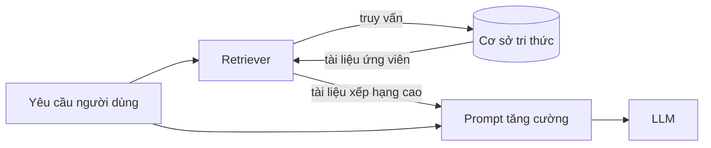
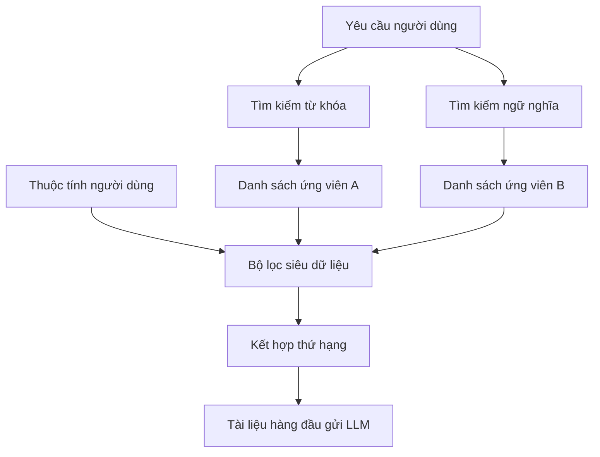

*Đây là phần 1 của seri 4 phần về nửa "truy xuất" trong Retrieval-Augmented Generation. Ta bắt đầu từ hình dạng của một retriever và thành phần đơn giản nhất của nó: lọc siêu dữ liệu. Các phần sau sẽ nói về tìm kiếm từ khóa, tìm kiếm ngữ nghĩa và xếp hạng kết hợp.*

## Truy xuất nằm ở đâu

Hệ thống RAG nhận yêu cầu của bạn và chuyển nó tới **hệ thống truy xuất** trước khi LLM kịp nhìn thấy. Retriever có quyền truy cập vào một **cơ sở tri thức** — tập hợp các tệp văn bản nằm trong một cơ sở dữ liệu. Nhiệm vụ của nó là quyết định thật nhanh tài liệu nào khớp nhất, rồi trả chúng về để ghép vào prompt tăng cường.

## Hai cách tìm kiếm

Gần như mọi retriever hiện đại đều dùng hai kỹ thuật tìm kiếm song song.

Thứ nhất là **tìm kiếm từ khóa**: retriever tìm các tài liệu chứa chính xác những từ trong yêu cầu. Không hào nhoáng, nhưng đã được kiểm chứng qua nhiều thập kỷ.

Thứ hai là **tìm kiếm ngữ nghĩa**: retriever tìm các tài liệu có *ý nghĩa* tương tự. Cách này linh hoạt hơn — nó có thể lôi ra tài liệu liên quan mà không hề dùng đúng từ ngữ người dùng đã gõ.

Hai cách hỏng theo hai hướng ngược nhau. Tìm kiếm từ khóa bỏ lỡ cách diễn đạt khác; tìm kiếm ngữ nghĩa có thể trôi về "gần đúng" khi bạn cần chính xác. Đó là lý do chúng được dùng cùng nhau.

## Một lượt truy xuất diễn ra thế nào

Mỗi kỹ thuật trả về một tập tài liệu — thường từ 20 đến 50 tài liệu mỗi tập.

Hai danh sách thường trùng nhau, nhưng vì cách tìm khác nhau, cùng một tài liệu có thể xếp cao ở danh sách này và thấp ở danh sách kia. Sự bất đồng đó là tín hiệu, không phải nhiễu.

Mỗi danh sách sau đó được lọc theo **siêu dữ liệu**. Có tài liệu thuộc nhóm kỹ thuật, có tài liệu thuộc Nhân sự; hệ thống biết người dùng thuộc nhóm nào và chỉ cho tài liệu của bộ phận đó đi tiếp.

Giờ retriever có hai danh sách đã lọc. Chúng được kết hợp thành một thứ hạng cuối cùng, và retriever trả về phần đầu của danh sách đó. Truy xuất xong — tài liệu được đưa vào prompt tăng cường.

## Tìm kiếm lai, nói ngắn

Cách kết hợp này gọi là **tìm kiếm lai (hybrid search)** vì thứ hạng cuối cùng dựa trên nhiều hơn một kỹ thuật.

- Tìm kiếm từ khóa giữ cho hệ thống nhạy với chính xác những từ người dùng đã gõ.
- Tìm kiếm ngữ nghĩa giữ cho hệ thống linh hoạt về ý nghĩa, kể cả khi cách diễn đạt khác đi.
- Lọc siêu dữ liệu cho phép loại tài liệu theo tiêu chí nghiêm ngặt mà không phương pháp nào khác làm được.

Thiết kế một retriever hiệu năng cao nghĩa là hiểu điểm mạnh tương đối của từng mảnh, rồi tinh chỉnh cân bằng giữa chúng cho dự án của bạn. Phần còn lại của seri sẽ đi vào từng mảnh, bắt đầu với mảnh đơn giản nhất.

## Lọc siêu dữ liệu

Lọc siêu dữ liệu là kỹ thuật đơn giản nhất và có lẽ quen thuộc nhất bên trong một retriever. Nó dùng **tiêu chí nghiêm ngặt** để thu hẹp tài liệu được trả về, dựa trên siêu dữ liệu của tài liệu: tiêu đề, tác giả, ngày tạo, quyền truy cập, v.v.

### Kho lưu trữ của một tờ báo

Giả sử bạn làm ở một tờ báo và muốn xây retriever trên toàn bộ bài viết trong lịch sử. Cơ sở tri thức chứa hàng nghìn bài, mỗi bài gắn thẻ siêu dữ liệu: tiêu đề, ngày xuất bản, tác giả, chuyên mục.

Dù toàn văn nằm đâu đó trong cơ sở tri thức, chỉ mục này cho phép tìm chỉ dựa trên siêu dữ liệu. Truy vấn trông rất giống SQL. Lọc một trường để tìm mọi bài của một ngày, hoặc mọi bài của một tác giả. Lọc nhiều trường để lấy mọi bài ở mục ý kiến từ tháng 6 đến tháng 7 năm 2024 của cây bút bạn thích. Chỉ bài thỏa *mọi* điều kiện mới được trả về.

Nếu bạn từng lọc một bảng trong bảng tính, bạn đã làm lọc siêu dữ liệu rồi. Bạn đang áp một bộ tiêu chí nghiêm ngặt để xác định thành viên nào của một tập dữ liệu lớn hơn mà bạn muốn giữ lại.

### Lọc siêu dữ liệu trong RAG

Trong một hệ thống RAG điển hình, bạn không dùng lọc siêu dữ liệu *để* truy xuất. Bạn dùng nó để thu hẹp kết quả do các kỹ thuật khác sinh ra.

Bản thân các bộ lọc thường không xuất phát từ những gì người dùng gõ. Chúng đến từ các thuộc tính khác của người đưa ra yêu cầu. Trong ví dụ tờ báo, một số bài miễn phí và số khác chỉ dành cho người đăng ký trả phí, mỗi bài có trường siêu dữ liệu ghi lại điều đó. Khi người dùng tìm kiếm, hệ thống phát hiện được họ có đăng nhập bằng tài khoản trả phí hay không. Nếu không, bộ lọc được đặt để loại các bài trả phí. Tương tự, nếu báo có nhiều ấn bản khu vực, mỗi bài lưu khu vực xuất bản; hệ thống phát hiện người đọc đang ở đâu và chỉ trả bài từ khu vực của họ.

### Điểm mạnh

- **Đơn giản về khái niệm.** Dễ hiểu, dễ gỡ lỗi.
- **Nhanh, trưởng thành, tối ưu tốt.** Đây là hạ tầng đã được giải quyết xong, nhàm chán theo nghĩa tốt.
- **Bộ lọc cứng duy nhất.** Đây là phương pháp duy nhất cho phép quyết định, theo tiêu chí nghiêm ngặt, một tài liệu có được phép truy xuất hay không.

Nếu bạn cần một bảo đảm — không nội dung trả phí, không ấn bản khu vực khác — thì không kỹ thuật xếp hạng nào làm được. Chỉ bộ lọc làm được.

### Hạn chế

Lọc siêu dữ liệu **không thực sự là một kỹ thuật tìm kiếm**. Nó là công cụ tinh chỉnh đầu ra của hai kỹ thuật kia.

Nó cũng **cứng nhắc**: tài liệu hoặc qua, hoặc không. Nó **bỏ qua nội dung** — một bài có siêu dữ liệu khớp hoàn hảo vẫn có thể vô dụng. Và sau khi qua bộ lọc, **không có cách nào xếp hạng** chúng; mọi thứ sống sót đều ngang nhau, vô nghĩa khi có 400 bài cùng khớp.

Hệ thống RAG của bạn gần như chắc chắn sẽ có bộ lọc siêu dữ liệu, nhưng một retriever chỉ dựa vào chúng thì vô dụng. Nó chỉ có giá trị khi đứng cạnh một kỹ thuật tìm kiếm thật sự.

Tiếp theo: tìm kiếm từ khóa, và các thuật toán chấm điểm — TF-IDF và BM25 — khiến những từ chính xác trở nên mạnh mẽ đáng ngạc nhiên.
