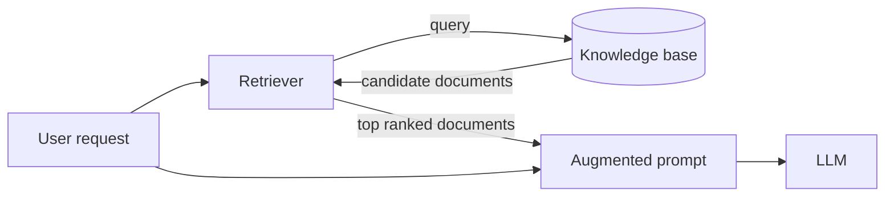
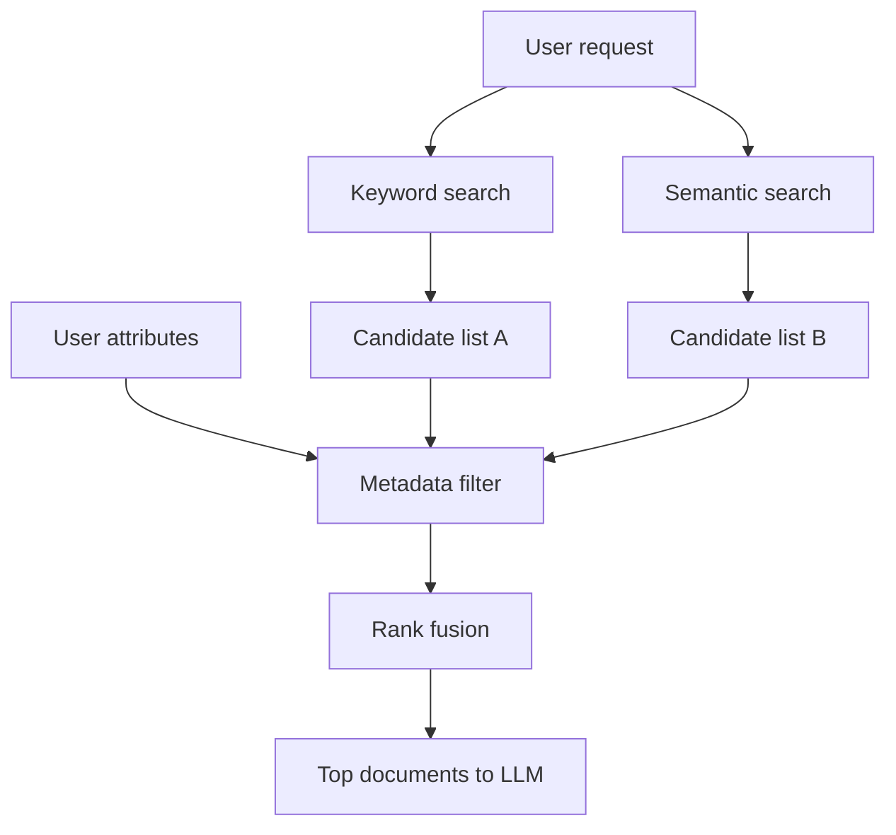

*This is part 1 of a 4-part series on the retrieval half of Retrieval-Augmented Generation. We start with the shape of a retriever and its simplest component, metadata filtering. Later parts cover keyword search, semantic search, and hybrid ranking.*

## Where retrieval fits

A RAG system receives your request and hands it to a **retrieval system** before the LLM ever sees it. The retriever has access to a **knowledge base** — a collection of text files sitting in a database. Its job is to decide, quickly, which documents best match the request, and return them for the augmented prompt.

## Two ways to search

Almost every modern retriever uses two search techniques side by side.

The first is **keyword search**: the retriever looks for documents containing the exact words in the request. Unglamorous, but proven over decades.

The second is **semantic search**: the retriever looks for documents whose *meaning* is similar. This is more flexible — it can surface a relevant document that never uses the user's exact wording.

The two fail in opposite directions. Keyword search misses paraphrases; semantic search can drift toward "close enough" when you needed precision. That is why they are used together.

## What one retrieval run looks like

Each technique returns a set of documents — typically 20 to 50 per set.

The lists usually overlap, but because the searches work differently, the same document can rank high in one and low in the other. That disagreement is signal, not noise.

Each list is then filtered on its **metadata**. Some documents may belong to engineering, others to HR; the system knows the user's team and lets through only that department's documents.

Now the retriever has two filtered lists. They are combined into one final ranking, and the retriever returns the top of it. Retrieval is done — the documents go into the augmented prompt.

## Hybrid search, briefly

This combination is called **hybrid search** because the final ranking rests on more than one technique.

- Keyword search keeps the system sharp about the exact words the user typed.
- Semantic search keeps it flexible about meaning, even when the wording differs.
- Metadata filtering lets it exclude documents on strict criteria that no other method can enforce.

Designing a high-performance retriever means understanding the relative strengths of each and then tuning the balance between them for your project. We will spend the rest of the series on the individual pieces, starting with the simplest one.

## Metadata filtering

Metadata filtering is the simplest and probably most familiar technique inside a retriever. It uses **strict criteria** to narrow the documents returned, based on the documents' metadata: title, author, creation date, access rights, and so on.

### A newspaper archive

Say you work at a newspaper and want to build a retriever over every article ever published. The knowledge base holds thousands of articles, each tagged with metadata: headline, publication date, author, section.

Even though the full text lives somewhere in the knowledge base, this index lets you search the metadata alone. Queries look a lot like SQL. Filter on one field to find every article from a given date, or everything by one author. Filter on several to get all opinion pieces from June to July 2024 by your favourite columnist. Only articles satisfying *every* condition come back.

If you have ever filtered a spreadsheet, you have already done metadata filtering. You are applying a strict set of criteria to decide which members of a larger dataset you want.

### Metadata filtering inside RAG

In a typical RAG system you do not use metadata filtering *as* the retrieval method. You use it to narrow the results produced by the other techniques.

The filters themselves are usually not derived from what the user typed. They come from other attributes of the person making the request. In the newspaper example, some articles are free and others are behind a paywall, and each article carries a metadata field recording which. When a user searches, the system can detect whether they are signed in as a paying subscriber. If not, the filter is set to exclude paywalled articles. Likewise, if the paper publishes regional editions, each article stores its region; the system can detect where the reader is and return only articles from their region.

### Strengths

- **Conceptually simple.** Easy to understand, easy to debug.
- **Fast, mature, well optimised.** This is solved, boring infrastructure.
- **The only hard filter.** It is the only method that lets you decide, on strict criteria, whether a document may be retrieved at all.

If you need a guarantee — no paywalled content, no other region's edition — no ranking technique can give it. Only a filter can.

### Limits

Metadata filtering is **not really a search technique**. It is a tool for refining the output of the other two.

It is also **rigid**: a document either passes or it does not. It **ignores content** — an article whose metadata matches perfectly might be irrelevant. And after documents pass, there is **no way to rank them**; everything that survives is equal, which is useless when 400 articles match.

Your RAG systems will almost certainly include metadata filters, but a retriever built *only* on them is essentially useless. It earns its keep alongside a real search technique.

Next up: keyword search, and the scoring algorithms — TF-IDF and BM25 — that make exact words surprisingly powerful.
