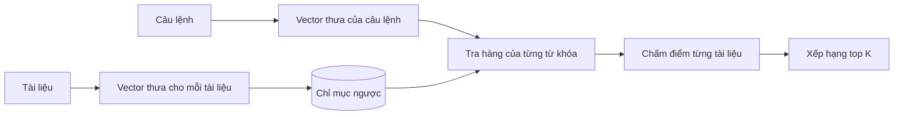
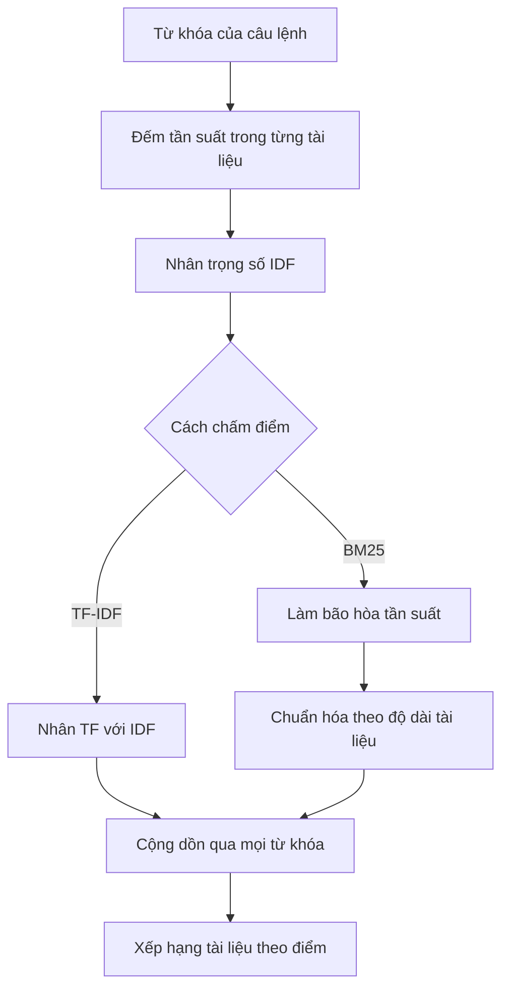

*Đây là phần 2 của seri 4 phần về truy xuất thông tin. Phần 1 đã nói về kiến trúc bộ truy xuất và lọc siêu dữ liệu. Ở đây ta xem kỹ thuật lâu đời nhất trong bộ công cụ — và vẫn là chuẩn đối sánh khó vượt qua nhất.*

## Khớp từ, không khớp nghĩa

Tìm kiếm từ khóa truy xuất tài liệu vì chúng **có chung các từ** với câu lệnh. Giả định bên dưới rất đơn giản và bền bỉ: tài liệu chia sẻ nhiều từ với câu lệnh thì có khả năng liên quan cao hơn.

Nó đã vận hành các công cụ tìm kiếm suốt nhiều thập kỷ, và trong một bộ truy xuất RAG hiện đại nó vẫn là một trong hai danh sách được hợp nhất ở bước cuối. Điểm yếu của nó cũng đơn giản không kém: nó chỉ biết đúng những từ bạn đã gõ.

## Bag of words

Cả câu lệnh và mỗi tài liệu đều được xử lý như một **túi từ (bag of words)**. Thứ tự từ bị bỏ hoàn toàn. Tất cả những gì còn lại là những từ nào xuất hiện, và xuất hiện bao nhiêu lần.

Câu `"making pizza without a pizza oven"` trở thành `pizza` ×2, `making` ×1, `without` ×1, `a` ×1, `oven` ×1. Ngữ pháp biến mất; số đếm ở lại. Nghe có vẻ thô — nhưng những con số đếm này lại là tín hiệu mạnh về mức độ liên quan chủ đề.

## Vector thưa

Các số đếm đó nằm trong một vector với **một vị trí cho mỗi từ trong từ điển**. Từ điển thực tế có hàng chục nghìn từ, nên gần như mọi vị trí đều bằng không. Vector như vậy gọi là **vector thưa (sparse vector)**.

Câu lệnh cũng có một vector tương tự. Giờ câu hỏi "tài liệu này có khớp với câu lệnh không?" trở thành "hai vector này có trùng nhau ở đâu, và trùng bao nhiêu?"

## Ma trận tài liệu - thuật ngữ và chỉ mục ngược

Xếp mỗi tài liệu thành một vector thưa và chồng lên nhau, bạn có **ma trận tài liệu - thuật ngữ**: mỗi cột là một tài liệu, mỗi hàng là một từ.

Đọc lưới đó theo hàng, bạn có **chỉ mục ngược (inverted index)**. Bình thường bạn bắt đầu từ một tài liệu và hỏi nó chứa những từ nào. Đảo ngược lại, bạn bắt đầu từ một từ và hỏi những tài liệu nào chứa nó — đúng hướng mà một truy vấn cần.

Chỉ mục được xây **một lần**, trước mọi tìm kiếm. Lúc truy vấn, bạn chỉ cần chuyển câu lệnh thành vector thưa rồi đi dọc các hàng của từ khóa. Đó là lý do tìm kiếm từ khóa nhanh.

## Chấm điểm: phiên bản ngây thơ

Cách đơn giản nhất: **một điểm cho mỗi từ khóa có mặt**. Câu lệnh năm từ vì thế có điểm tối đa là năm.

Nó đã tạo ra một thứ hạng dùng được, nhưng bỏ qua việc một tài liệu có thể nhắc từ khóa mười lần — thường là dấu hiệu của mức liên quan mạnh hơn.

## Chấm điểm theo tần suất

Vậy hãy cộng đúng số lần xuất hiện: đi dọc hàng của từng từ khóa và cộng con số nằm trong cột của mỗi tài liệu.

Cách này lập tức tạo ra vấn đề mới. Tài liệu dài tích điểm chỉ vì nó dài. Một tài liệu 5.000 từ sẽ nhắc gần như mọi thứ thường xuyên hơn một tài liệu 200 từ.

## Chuẩn hóa tần suất thuật ngữ

Chia điểm của mỗi tài liệu cho số từ của nó. Giờ bạn đang đo **tỷ trọng** của tài liệu dành cho từ khóa, chứ không phải số đếm thô. Một tài liệu ngắn, tập trung có thể thắng một tài liệu dài, lan man.

## Không phải từ nào cũng quan trọng như nhau

Chuẩn hóa TF vẫn cho mọi từ khóa trọng số như nhau — `"the"` đáng điểm ngang `"pizza"`. Điều đó ngược đời. `"the"` xuất hiện trong gần như mọi tài liệu, nên sự có mặt của nó chẳng nói lên điều gì. Còn `"pizza"` xuất hiện là bằng chứng thật.

## TF-IDF

**TF-IDF** gán trọng số cho mỗi từ dựa trên độ hiếm của nó trong toàn bộ cơ sở tri thức.

**Tần suất tài liệu (DF)** = số tài liệu chứa từ ÷ tổng số tài liệu.

Với 100 tài liệu:

- `"pizza"` trong 5 tài liệu → DF = **0,05**
- `"the"` trong cả 100 tài liệu → DF = **1**

Từ hiếm phải được điểm cao hơn, nên đảo ngược phân số: **IDF = 1/DF**. Pizza được **20**, `"the"` chỉ được **1**.

Với tỷ lệ đó, từ hiếm bị thưởng quá tay, nên trong thực tế người ta dùng **log(IDF)** — từ hiếm vẫn có trọng số lớn hơn, nhưng ít bị phóng đại hơn nhiều.

Sau đó nhân mỗi hàng trong chỉ mục ngược với IDF của từ tương ứng. Kết quả là **ma trận TF-IDF**. Chấm điểm câu lệnh y như trước: với mỗi từ khóa, đi dọc hàng của nó và cộng giá trị TF-IDF trong cột của từng tài liệu.

Những tài liệu dùng từ khóa của câu lệnh thường xuyên — đặc biệt là các từ hiếm — sẽ vươn lên đầu. Điểm đó là **chuẩn cơ sở cho truy xuất từ khóa**: con số mà mọi phương pháp cầu kỳ hơn đều phải vượt qua.

## BM25

Các bộ truy xuất hiện đại chủ yếu dùng **BM25** — *Best Matching 25*, biến thể thứ 25 trong loạt hàm chấm điểm mà những người tạo ra nó đề xuất. Nó giữ nguyên dạng của TF-IDF và sửa hai chỗ thô.

**Bão hòa tần suất thuật ngữ.** Hai mươi lần nhắc `"pizza"` không thực sự liên quan gấp đôi mười lần. Mỗi lần xuất hiện thêm chỉ được điểm giảm dần, nên điểm phẳng ra thay vì tăng theo đường thẳng.

**Chuẩn hóa độ dài tài liệu, với hình phạt giảm dần.** TF-IDF phạt tài liệu dài bằng cách chia cho độ dài, và có thể phạt quá nặng một tài liệu dài vốn thực sự bàn về chủ đề. Hình phạt của BM25 tăng chậm hơn, nên tài liệu dài vẫn đạt điểm cao khi tần suất từ khóa thật sự lớn.

**Hai siêu tham số có thể tinh chỉnh** kiểm soát tốc độ bão hòa tần suất và mức độ phạt độ dài. Trong một bộ truy xuất thực tế, bạn tinh chỉnh chúng theo dữ liệu của chính mình.

Với chi phí tính toán tương đương, BM25 thường thắng TF-IDF, và các núm tinh chỉnh khiến nó thích nghi tốt hơn nhiều với một tập dữ liệu cụ thể. Đó là lý do nó vẫn là thuật toán từ khóa mặc định nhiều thập kỷ sau khi ra đời.

## Những điều cần mang theo

- Tìm kiếm từ khóa khớp các từ chung: càng nhiều từ chung, càng liên quan.
- Bag of words bỏ qua thứ tự; vector thưa giữ số đếm.
- Chỉ mục ngược đi từ từ → tài liệu và được xây một lần.
- TF-IDF gán trọng số theo độ hiếm; BM25 làm dịu hiệu ứng tần suất và độ dài.

Điểm mù của nó là cách dùng từ chính xác. Tìm `"glad"` sẽ bỏ lỡ tài liệu viết `"happy"` — cùng nghĩa, không chung từ nào. Lấp khoảng trống đó là việc của tìm kiếm ngữ nghĩa, phần 3.
