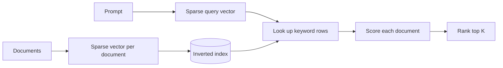
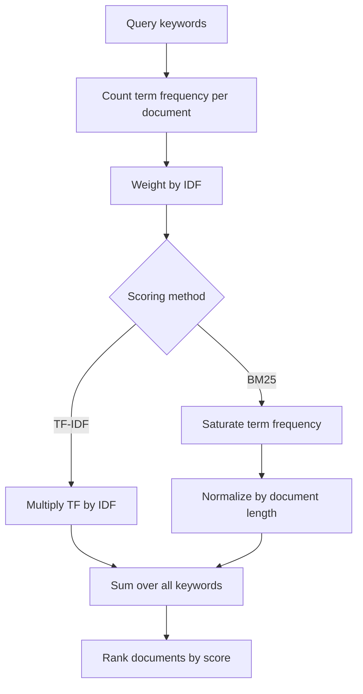

*This is part 2 of a 4-part series on information retrieval. Part 1 covered the retriever architecture and metadata filtering. Here we look at the oldest technique in the toolbox — and still the hardest baseline to beat.*

## Matching words, not meanings

Keyword search retrieves documents because they **share words** with the prompt. The assumption is simple and durable: a document that shares more words with the prompt is more likely to be relevant.

It powered search engines for decades, and inside a modern RAG retriever it is still one of the two ranked lists you merge at the end. Its weakness is equally simple: it only knows the exact words you typed.

## Bag of words

Both the prompt and every document are treated as a **bag of words**. Word order is discarded. All that survives is which words appear, and how often.

`"making pizza without a pizza oven"` becomes `pizza` ×2, `making` ×1, `without` ×1, `a` ×1, `oven` ×1. Grammar is gone; counts remain. That sounds crude — but those counts are a strong signal for topical relevance.

## Sparse vectors

The counts live in a vector with **one slot per term in the vocabulary**. A real vocabulary holds tens of thousands of terms, so almost every slot is zero. Vectors like this are **sparse vectors**.

The prompt gets one too. Now "does this document match this prompt?" becomes "do these two vectors overlap, and where?"

## The document-term matrix and the inverted index

Stack one sparse vector per document and you get the **document-term matrix**: each column a document, each row a term.

Read it row-first and you get the **inverted index**. Normally you start from a document and ask which words it contains. Inverted, you start from a word and ask which documents contain it — exactly the direction a query needs.

The index is built **once**, before any search. At query time you only convert the prompt into a sparse vector and walk the rows for its keywords. That is why keyword search is fast.

## Scoring: the naive version

Simplest scoring: **one point per keyword present**. A five-word prompt has a maximum of five.

It already produces a usable ranking, but ignores that a document may mention a keyword ten times — usually a sign of stronger relevance.

## Frequency scoring

So award the actual count: walk each keyword's row and add the number stored in every document's column.

This creates a new problem. Long documents accumulate counts just by being long. A 5,000-word document mentions almost anything more often than a 200-word one.

## Normalized term frequency

Divide each document's score by its word count. Now you measure the **share** of the document devoted to the keyword, not the raw count. A short, focused document can beat a long, sprawling one.

## Not all words are equal

Normalized TF still gives every keyword the same weight — `"the"` counts as much as `"pizza"`. Backwards. `"the"` appears in nearly every document, so its presence tells you nothing. `"pizza"` appearing is real evidence.

## TF-IDF

**TF-IDF** weights each term by how rare it is across the knowledge base.

**Document frequency (DF)** = documents containing the term ÷ total documents.

With 100 documents:

- `"pizza"` in 5 → DF = **0.05**
- `"the"` in 100 → DF = **1**

Rare terms should score higher, so invert: **IDF = 1/DF**. Pizza gets **20**, `"the"` gets **1**.

That ratio rewards rare terms too aggressively, so in practice you use **log(IDF)** — still larger for rare terms, far less exaggerated.

Then multiply every row of the inverted index by its term's IDF. The result is the **TF-IDF matrix**. Score a prompt as before: for each keyword, walk its row and add the TF-IDF value in each document's column.

Documents that use the query keywords often — especially the rare ones — rise to the top. That score is the **baseline for keyword retrieval**: the number any fancier method has to beat.

## BM25

Modern retrievers mostly use **BM25** — *Best Matching 25*, the 25th variant in a series of scoring functions its authors proposed. It keeps the TF-IDF shape and fixes two rough edges.

**Term frequency saturation.** Twenty mentions of `"pizza"` is not twice as relevant as ten. Each additional occurrence earns diminishing returns, so scores flatten instead of climbing in a straight line.

**Document length normalization, with diminishing penalties.** TF-IDF divides by length, which can over-penalize a long document that genuinely discusses the topic. BM25's penalty grows more slowly, so long documents still score well when keyword frequency is high.

**Two tunable hyperparameters** control how fast frequency saturates and how hard length is penalized. In a real retriever you tune these on your own data.

At similar compute cost, BM25 usually beats TF-IDF, and the knobs make it far more adaptable. That is why it is still the default decades later.

## What to carry forward

- Keyword search matches shared words: more shared words, higher relevance.
- Bag of words ignores order; sparse vectors hold the counts.
- The inverted index goes word → documents and is built once.
- TF-IDF weights terms by rarity; BM25 softens frequency and length effects.

Its blind spot is exact wording. Ask for `"glad"` and it misses a document that says `"happy"` — same meaning, no shared word. Closing that gap is the job of semantic search, which is part 3.
