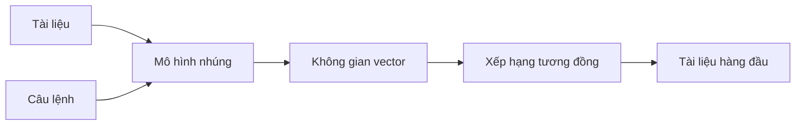
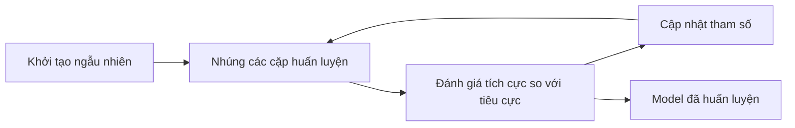

*Phần 3 của seri 4 bài về truy xuất thông tin. Phần 2 đã nói về tìm kiếm từ khóa — TF-IDF và BM25. Giờ là nửa còn lại của một retriever hiện đại: khớp theo ý nghĩa.*

## Khi đúng từ vẫn là sai từ

Tìm kiếm từ khóa nhanh và khó bị đánh bại hơn ta tưởng, nhưng nó chỉ biết chuỗi ký tự, không biết chúng có nghĩa gì. Hai kiểu thất bại lặp lại liên tục:

- **Từ đồng nghĩa.** Người dùng tìm *"happy"* trong khi tài liệu viết *"glad"*. Cùng nghĩa, không có kết quả.
- **Tính mơ hồ.** *"Python"* là ngôn ngữ lập trình và *"Python"* là con rắn tạo ra cùng một token, nên hai tài liệu được chấm điểm như nhau.

Tìm kiếm ngữ nghĩa giải quyết cả hai bằng cách khớp theo ý nghĩa thay vì hình thức bề mặt.

## Cùng một quy trình, khác cách tạo vector

Ở mức khái quát, tìm kiếm ngữ nghĩa hoạt động như tìm kiếm từ khóa: mỗi tài liệu thành một vector, câu lệnh thành một vector, hai bên được so sánh để tạo điểm, và điểm cao nhất thắng.

Khác biệt nằm ở nguồn gốc vector: tìm kiếm từ khóa đếm các từ trong từ điển, còn tìm kiếm ngữ nghĩa chạy văn bản qua một mô hình toán học gọi là **mô hình nhúng (embedding model)**.

## Ý nghĩa nằm ở đâu

Mô hình nhúng ánh xạ văn bản tới một vị trí trong không gian, biểu diễn bằng một vector. *"Pizza"* có thể thành `[3, 1]` và *"bear"* thành `[5, 2]` — hai điểm trên mặt phẳng.

Phần nghe như phép thuật: những từ có ý nghĩa tương đồng nằm gần nhau. *"Food"* ở cạnh *"cuisine"*. *"Trombone"* ở xa *"cat"*. Ý nghĩa tương đồng tạo ra vị trí tương đồng.

Các trục không có cách giải thích đơn giản. Không có "trục thức ăn" nào để chỉ vào. Đừng đọc ý nghĩa từ một tọa độ — hãy hình dung các điểm lơ lửng trên mặt phẳng, những từ liên quan tụ thành cụm.

Hai chiều thì chật; ba chiều cho các cụm chỗ để tách ra. Model thực tế dùng hàng trăm hoặc hàng nghìn chiều: không thể vẽ ra, nhưng toán học vẫn vậy — khái niệm tương tự ở gần, khác biệt ở xa. Có model cho từ, cho câu, và cho cả tài liệu; đầu ra luôn là một vector.

## Câu cũng hoạt động như vậy

1. *"He spoke softly in class."* — Anh ấy nói khẽ trong lớp.
2. *"He whispered quietly during class."* — Anh ấy thì thầm trong giờ học.
3. *"Her daughter brightened the gloomy day."* — Con gái cô ấy làm bừng sáng ngày u ám.

Hai câu đầu gần như không chung từ nào — *spoke* với *whispered*, *softly* với *quietly* — nhưng mô tả cùng một tình huống, nên vector nằm sát nhau. Câu thứ ba nói chuyện khác và ở xa. Tìm kiếm từ khóa thấy rất ít điểm chung giữa câu 1 và 2; mô hình nhúng thấy chúng cùng nghĩa.

## Đo mức độ gần nhau giữa hai vector

Sự tương đồng trở thành bài toán hình học. Ba thước đo xuất hiện liên tục:

| Thước đo | Nó đo gì | Ghi chú |
|---|---|---|
| **Khoảng cách Euclidean** | Khoảng cách đường thẳng | Pythagoras trong N chiều. Ở nhiều chiều, mọi điểm có xu hướng xa nhau, nên khoảng cách thô ít thông tin. |
| **Độ tương đồng cosine** | Góc giữa hai vector, bỏ qua độ dài | `(10, 10)` và `(100, 100)` cùng hướng, nên tương đồng bằng 1. Miền giá trị -1 đến 1. Phổ biến nhất. |
| **Tích vô hướng** | Độ dài hình chiếu | Lớn khi hai vector cùng hướng và cùng độ lớn. Bằng 0 ở 90°, âm khi ngược hướng. |

Với cosine và tích vô hướng, cao hơn là giống hơn; với Euclidean thì ngược lại. Biết chiều của điểm số giúp tránh nhầm lẫn khi đọc bảng xếp hạng.

## Tìm kiếm ngữ nghĩa trong bốn bước

1. **Nhúng toàn bộ tài liệu** một lần, từ trước, và lưu vector vào chỉ mục.
2. **Nhúng câu lệnh** bằng cùng model.
3. **Đo khoảng cách** giữa vector câu lệnh và từng vector tài liệu.
4. **Sắp xếp và trả về** những tài liệu gần nhất.

Thuật toán chỉ có vậy; mọi khó khăn nằm trong model.

## Mô hình nhúng học ý nghĩa thế nào

Mô tả công việc rất đơn giản: văn bản tương đồng lại gần, văn bản khác biệt ra xa.

Huấn luyện bắt đầu từ hai loại ví dụ. **Cặp tích cực** cùng nghĩa, như *"good morning"* và *"hello"* — nên kết thúc ở gần nhau. **Cặp tiêu cực** khác nghĩa, như *"good morning"* và *"a loud trombone"* — nên ở xa nhau. Hệ thống thực tế biên soạn hàng triệu cặp, mỗi cụm từ xuất hiện trong nhiều cặp.

Rồi vòng lặp chạy:

1. **Khởi tạo ngẫu nhiên.** Mỗi văn bản thành một vector vô nghĩa; truy xuất chỉ ra rác.
2. **Đánh giá.** Cặp tích cực đã tụ lại và cặp tiêu cực đã tách ra tốt đến đâu? Vì hiệu năng được đánh giá dựa trên sự tương phản, đây là **huấn luyện tương phản**.
3. **Cập nhật tham số** để tích cực lại gần và tiêu cực ra xa.
4. **Lặp lại.** Nhúng lại, đánh giá, cập nhật tiếp.

## Từ góc nhìn một điểm neo

Xét quá trình từ góc độ một cụm từ — một **điểm neo (anchor)**. Lấy *"he could smell roses"*. Nó tạo cặp tích cực với *"a fragrant field of flowers"* và cặp tiêu cực với *"a lion roared"*.

Điểm neo kéo cụm về hoa lại gần và đẩy cụm về sư tử ra xa. Giờ hình dung hàng triệu điểm neo làm vậy cùng lúc, mọi vector bị kéo theo nhiều hướng. Qua nhiều vòng, các lực ổn định thành một sắp xếp nơi ý nghĩa được bảo toàn dưới dạng khoảng cách.

Đây cũng là lý do vector cần nhiều chiều. Mỗi chiều là thêm chỗ để thỏa các ràng buộc xung đột — đặt *hoa hồng* gần *hoa* mà không kéo nó lại gần *sư tử*.

## Hai điều cần nhớ

**Hình học mang tính trừu tượng.** Trước khi huấn luyện, các vị trí vô nghĩa. Sau đó, một vị trí chỉ có nghĩa vì một cụm khái niệm đã hình thành ở đó. Huấn luyện hai lần với khởi đầu ngẫu nhiên khác nhau, các cụm tương tự vẫn xuất hiện ở những vùng khác nhau. Tọa độ không phải đặc trưng; vị trí tương đối mới mang ý nghĩa.

**Không bao giờ so sánh vector giữa các model.** Các model khác nhau về dữ liệu, số chiều và seed. Đầu ra của chúng cho ra những con số trông như điểm tương đồng nhưng vô nghĩa.

## Ta đang ở đâu

Tìm kiếm ngữ nghĩa mua được sự linh hoạt mà tìm kiếm từ khóa không có, với cái giá là những kết quả nghe hợp lý nhưng sai và bỏ lỡ các định danh chính xác.

Trong phần cuối, ta kết hợp cả hai — cùng bộ lọc siêu dữ liệu — thành tìm kiếm lai, và đo xem toàn bộ hệ thống có thực sự hoạt động không.
