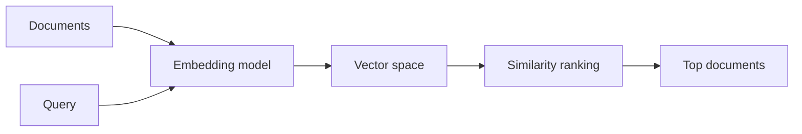
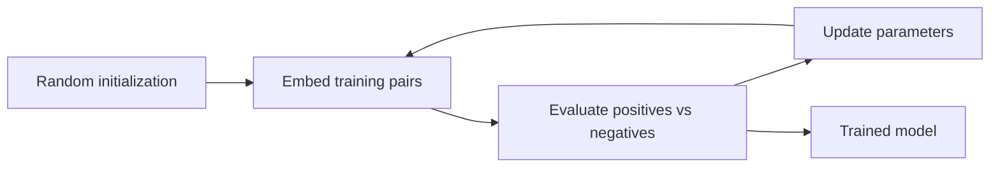

*Part 3 of a 4-part series on information retrieval. Part 2 covered keyword search — TF-IDF and BM25. Now the other half of a modern retriever: matching by meaning.*

## When the right words are the wrong words

Keyword search is fast and surprisingly hard to beat, but it only knows about strings, not what they mean. Two failures repeat constantly:

- **Synonyms.** A query for *"happy"* misses a document that says *"glad"*. Same meaning, no result.
- **Ambiguity.** *"Python"* the language and *"Python"* the snake are the same token, so both documents score identically.

Semantic search fixes both by matching on meaning instead of surface form.

## Same pipeline, different vectors

At a high level, semantic search works like keyword search: every document becomes a vector, the query becomes a vector, the two are compared to produce a score, and the best scores win.

The difference is where the vectors come from: keyword search counts dictionary words, while semantic search runs text through a mathematical model called an **embedding model**.

## Where meaning lives

An embedding model maps text to a position in space, represented by a vector. *"Pizza"* might become `[3, 1]` and *"bear"* `[5, 2]` — two points on a plane.

The part that sounds like magic: words with similar meaning land near each other. *"Food"* sits close to *"cuisine"*. *"Trombone"* sits far from *"cat"*. Similar meaning produces similar position.

The axes have no simple interpretation. There is no "food axis" you can point to. Don't read meaning into a coordinate — picture points floating on a plane, related words clumped together.

Two dimensions are cramped; three give clusters room to separate. Real models use hundreds or thousands of dimensions: impossible to visualize, but the same mathematics holds — similar concepts sit close, different ones sit far. Models exist for words, sentences, and documents; the output is always one vector.

## Sentences behave the same way

1. *"He spoke softly in class."*
2. *"He whispered quietly during class."*
3. *"Her daughter brightened the gloomy day."*

The first two share almost no words — *spoke* versus *whispered*, *softly* versus *quietly* — yet describe the same situation, so their vectors land close. The third is about something else and lands far away. Keyword search sees little overlap between 1 and 2; an embedding model sees they mean the same thing.

## Measuring how close two vectors are

Similarity becomes a geometry problem. Three measures come up constantly:

| Measure | What it captures | Notes |
|---|---|---|
| **Euclidean distance** | Straight-line distance | Pythagoras in N dimensions. In high dimensions everything trends far from everything, so raw distance is less informative. |
| **Cosine similarity** | Angle between vectors, ignoring length | `(10, 10)` and `(100, 100)` point the same way, so similarity is 1. Range -1 to 1. Most common. |
| **Dot product** | Projection length | Large when vectors agree in direction and magnitude. Zero at 90°, negative when opposite. |

For cosine and dot product, higher means more similar; for Euclidean, lower does. Knowing which way the score runs saves confusion when reading a ranking.

## Semantic search in four steps

1. **Embed every document** once, ahead of time, and store the vectors in an index.
2. **Embed the query** with the same model.
3. **Measure distance** between the query vector and each document vector.
4. **Sort and return** the closest documents.

That's the algorithm; all the difficulty lives in the model.

## How an embedding model learns meaning

The job description is simple: similar text close together, different text far apart.

Training starts from examples in two flavors. **Positive pairs** mean the same thing, like *"good morning"* and *"hello"* — they should end up near each other. **Negative pairs** mean different things, like *"good morning"* and *"a loud trombone"* — they should end up far apart. Real systems compile millions of pairs, with each phrase appearing in many of them.

Then the loop runs:

1. **Initialize randomly.** Every text maps to a meaningless vector; retrieval returns garbage.
2. **Evaluate.** How well are positives clustered and negatives separated? Because performance is judged on the contrast, this is **contrastive training**.
3. **Update parameters** so positives move closer and negatives further apart.
4. **Repeat.** Re-embed, evaluate, update again.

## One anchor at a time

Watch the process from one phrase's perspective — an **anchor**. Take *"he could smell roses"*. It forms a positive pair with *"a fragrant field of flowers"* and a negative pair with *"a lion roared"*.

The anchor pulls the flower phrase closer and pushes the lion phrase away. Now imagine millions of anchors doing this at once, every vector pulled in many directions. Over many rounds the forces settle into an arrangement where meaning survives as distance.

This is also why the vectors need so many dimensions. Each one is extra room to satisfy conflicting constraints — placing *roses* near *flowers* without also placing it near *lions*.

## Two things to remember

**The geometry is abstract.** Before training, positions mean nothing. Afterward, a position means something only because a cluster formed there. Train twice with different random starts and the same clusters appear in different regions. Coordinates are not features; relative placement carries the meaning.

**Never compare vectors across models.** Different models use different data, dimensions, and seeds. Their outputs give numbers that look like similarity scores and mean nothing.

## Where this leaves us

Semantic search buys flexibility keyword search lacks, at the price of plausible-but-wrong results and missed exact identifiers.

In the final part, we'll combine both — plus metadata filters — into hybrid search, and measure whether any of it actually works.
