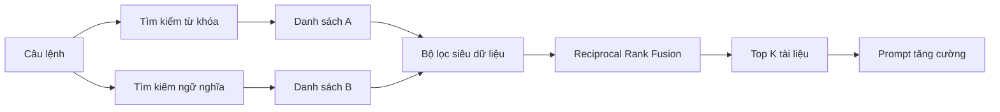
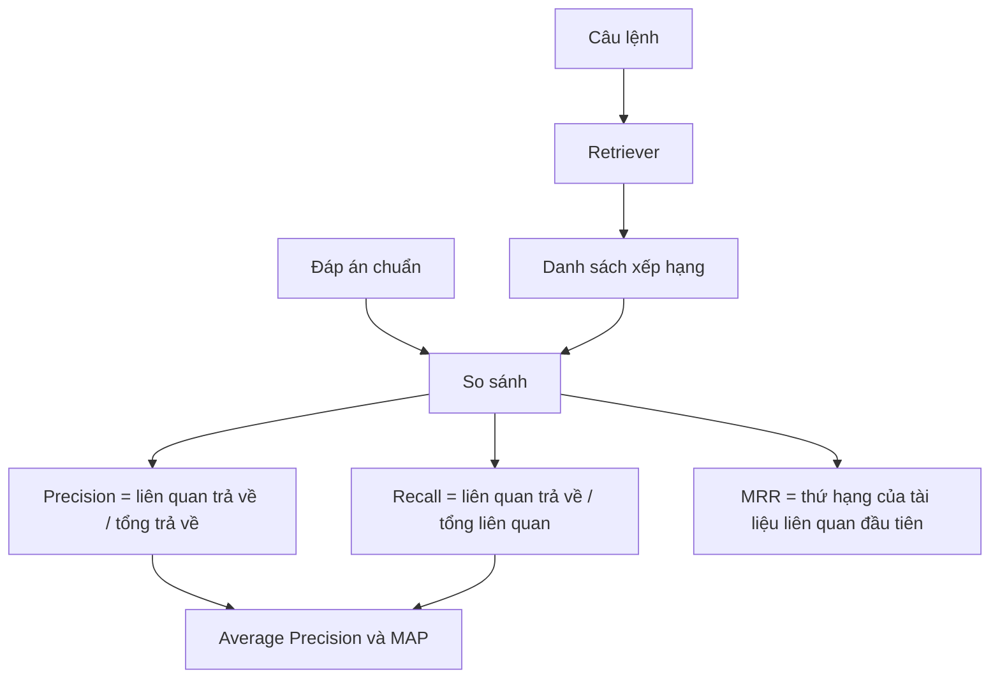

*Đây là phần 4 của seri 4 bài về tầng truy xuất trong hệ thống RAG. Ta đã có ba kỹ thuật; giờ là lúc kết hợp chúng, rồi học cách biết liệu sự kết hợp đó có thực sự tốt hay không.*

## Ba công cụ, ba nhiệm vụ

Mỗi kỹ thuật đã học đều có kiểu thất bại riêng — và đó chính là lý do chúng thuộc về nhau:

- **Lọc siêu dữ liệu** là một cổng chặn cứng, có-không. Nó không xếp hạng tài liệu — nó quyết định tài liệu có được phép lọt vào tập kết quả hay không. Nhanh, chính xác, và là công cụ duy nhất thực thi được những quy tắc như "chỉ tài liệu thuộc dự án này" hay "chỉ bài viết mà người đọc này được phép xem".
- **Tìm kiếm từ khóa** chấm điểm dựa trên các từ chung với câu lệnh. Nhanh, rẻ, và rất khó bị đánh bại khi câu lệnh chứa thuật ngữ kỹ thuật, mã lỗi hay tên sản phẩm chính xác.
- **Tìm kiếm ngữ nghĩa** chấm điểm dựa trên ý nghĩa. Chậm và tốn kém hơn, nhưng linh hoạt hơn: nó tìm được tài liệu ghi "glad" khi người dùng gõ "happy", và không nhầm ngôn ngữ Python với con rắn.

Không kỹ thuật nào đủ một mình. **Tìm kiếm lai** chạy cả ba cùng lúc và hợp nhất kết quả.

## Quy trình tìm kiếm lai

1. **Chạy song song hai kiểu tìm kiếm.** Câu lệnh đi tới chỉ mục từ khóa và tới mô hình nhúng cùng lúc. Mỗi bên trả về một danh sách đã xếp hạng riêng, thường 20 đến 50 tài liệu.
2. **Áp bộ lọc siêu dữ liệu lên cả hai danh sách.** Quyền truy cập, dự án, ngôn ngữ, ngày — bất cứ thứ gì ngữ cảnh yêu cầu ngụ ý. Tài liệu không qua bộ lọc bị loại khỏi cả hai danh sách.
3. **Hợp nhất bằng Reciprocal Rank Fusion.** Hai danh sách đã lọc trở thành một bảng xếp hạng duy nhất.
4. **Trả về Top K.** Những tài liệu đó được đưa vào prompt tăng cường, và quá trình truy xuất kết thúc.

## Reciprocal Rank Fusion

RRF bỏ qua điểm số thô và chỉ nhìn vào vị trí. Một tài liệu nhận `1 / thứ hạng` từ mỗi danh sách mà nó xuất hiện, rồi các đóng góp đó được cộng lại.

| Thứ hạng trong một danh sách | Điểm |
| --- | --- |
| 1 | 1.0 |
| 2 | 0.5 |
| 3 | 0.33 |
| 10 | 0.1 |

Vậy một tài liệu đứng thứ 2 trong danh sách từ khóa và thứ 10 trong danh sách ngữ nghĩa được `0.5 + 0.1 = 0.6`. Một tài liệu đứng thứ 5 ở cả hai danh sách được `0.2 + 0.2 = 0.4`. Sự đồng thuận giữa hai danh sách được thưởng, và một thứ hạng cao đơn lẻ vẫn có giá trị.

Việc bỏ qua điểm thô là một đặc điểm thiết kế, không phải cách làm tắt. Điểm BM25 không có giới hạn trên, độ tương đồng cosine nằm trong khoảng -1 đến 1, và hai loại này không thể cộng một cách có ý nghĩa. Còn thứ hạng thì so sánh được với nhau ngay từ đầu.

Hai siêu tham số định hình phép hợp nhất:

- **K** giảm bớt sự thống trị của các thứ hạng đầu bằng cách đổi mẫu số thành `1 / (K + thứ hạng)`. Với `K = 0`, hạng 1 đáng giá gấp mười lần hạng 10. Với `K` khoảng 50, khoảng cách đó co lại còn khoảng 1,2 lần — bảng xếp hạng phẳng hơn và khó bị một danh sách duy nhất thao túng.
- **Beta** đặt trọng số giữa hai danh sách. `Beta = 0.8` nghĩa là 80% ngữ nghĩa và 20% từ khóa. Tỷ lệ 70/30 là điểm khởi đầu tốt, rồi tinh chỉnh từ đó.

## Đo chất lượng truy xuất

Độ trễ, thông lượng và tài nguyên đều quan trọng, nhưng câu hỏi quan trọng nhất đơn giản hơn: **nó có tìm ra tài liệu liên quan không?**

Mọi chỉ số chất lượng đều cần ba nguyên liệu giống nhau:

1. Một **câu lệnh** — một truy vấn thật từ lưu lượng sử dụng của bạn.
2. **Danh sách đã xếp hạng** mà retriever trả về cho câu lệnh đó.
3. **Đáp án chuẩn** — mọi tài liệu trong cơ sở tri thức thực sự liên quan, tức là những gì retriever *lẽ ra* phải tìm thấy.

## Precision và Recall

**Precision** trả lời "trong những gì bạn trả về, bao nhiêu là hữu ích":

`Precision = số liên quan đã trả về / tổng số đã trả về`

**Recall** trả lời "trong những gì tồn tại, bạn tìm được bao nhiêu":

`Recall = số liên quan đã trả về / tổng số liên quan trong cơ sở tri thức`

Giả sử cơ sở tri thức có 10 tài liệu liên quan. Lần chạy 1 trả về 12 tài liệu, trong đó 8 liên quan: precision là `8/12 = 66%`, recall là `8/10 = 80%`. Bạn nới một cài đặt. Lần chạy 2 trả về 15 tài liệu, 9 liên quan: precision giảm còn `9/15 = 60%`, recall tăng lên `9/10 = 90%`.

Đó là đánh đổi quen thuộc. Trả về nhiều tài liệu hơn mua được recall và trả giá bằng precision, vì nhiễu cũng về theo. Cách duy nhất để tối đa cả hai là chỉ trả về đúng những tài liệu liên quan, và xếp chúng ở đầu.

## Chỉ số tại K

Vì các con số phụ thuộc vào số kết quả trả về, người ta thường báo cáo tại một ngưỡng: **Precision@5**, **Recall@10**, v.v. Các benchmark khắt khe thường nhìn Top 1 đến Top 5; hệ thống tầm trung thường quan tâm Top 5 đến Top 15. Hãy chọn ngưỡng khớp với số tài liệu thực sự vừa trong prompt của bạn.

## AP và MAP

**Average Precision** thưởng cho tài liệu liên quan khi chúng được xếp cao. Tính precision tại mỗi vị trí có tài liệu liên quan, rồi lấy trung bình các giá trị đó.

Nếu ba tài liệu liên quan nằm ở hạng 1, 3 và 5, các precision là `1/1`, `2/3` và `3/5`, nên `AP = (1 + 0,67 + 0,60) / 3 ≈ 0,76`. Một tài liệu rác ở vị trí 2 không chỉ tự làm hại mình — nó kéo precision của mọi tài liệu liên quan bên dưới xuống.

**MAP** là trung bình của AP trên nhiều câu lệnh. Một con số cho cả tập kiểm thử.

## MRR

**Mean Reciprocal Rank** chỉ quan tâm tới tài liệu liên quan đầu tiên. Nếu nó ở hạng 2, điểm là `1/2 = 0,5`; ở hạng 4 là `1/4 = 0,25`. Lấy trung bình trên nhiều truy vấn, bạn có MRR.

MRR là chỉ số đúng khi một kết quả tốt là đủ — ví dụ chatbot hỗ trợ chỉ cần đúng một bài viết, không cần cả danh sách đọc.

## Chọn chỉ số nào

- **Recall@K** là nền tảng. Nếu tài liệu liên quan không có trong danh sách, mọi kỹ thuật xếp hạng khéo léo đều vô nghĩa.
- **Precision và MAP** xây trên recall, cho biết bảng xếp hạng có sạch và đúng thứ tự không.
- **MRR** tập trung vào phần đầu bảng xếp hạng — nơi người dùng và LLM thực sự nhìn.

Đây là cách kiểm chứng việc tinh chỉnh. Đổi Beta từ 0,7 lên 0,8, chạy lại đánh giá, và để con số quyết định thay vì cảm giác. Cái giá là thật: ai đó phải gán nhãn thủ công đáp án chuẩn cho một tập câu lệnh đại diện. Đổi lại, bạn có một hệ thống theo dõi được cả khi phát triển lẫn khi vận hành, và cải thiện có chủ đích thay vì tình cờ.
