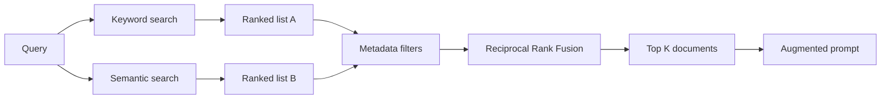
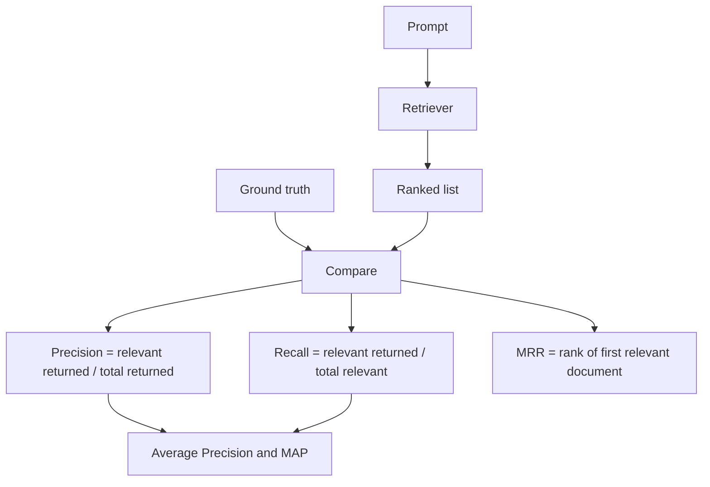

*Part 4 of a 4-part series on the retrieval layer of a RAG system. We have the three techniques; now we combine them and measure the result.*

## Three tools, three jobs

Each technique fails in a different way, which is why they belong together:

- **Metadata filtering** is a hard yes/no gate. It does not rank — it decides whether a document is allowed into the result set at all. It is the only tool that can enforce rules like "only documents from this project".
- **Keyword search** scores by shared words. Fast, cheap, and hard to beat when the query contains an exact technical term, error code, or product name.
- **Semantic search** scores by meaning. Slower and more expensive, but more flexible: it finds the document that says "glad" when the user typed "happy".

None is sufficient alone. **Hybrid search** runs them together and merges the results.

## The hybrid pipeline

1. **Run both searches in parallel.** The query goes to the keyword index and the embedding model at once. Each returns a ranked list, typically 20 to 50 documents.
2. **Apply metadata filters to both lists.** Access control, project, language, date. Documents that fail the filter are dropped.
3. **Merge with Reciprocal Rank Fusion.** Two filtered lists become one ranking.
4. **Return the top K** for the augmented prompt.

## Reciprocal Rank Fusion

RRF ignores raw scores and looks only at position. A document earns `1 / rank` from every list it appears in, and those contributions are summed.

| Rank in a list | Points |
| --- | --- |
| 1 | 1.0 |
| 2 | 0.5 |
| 3 | 0.33 |
| 10 | 0.1 |

A document at rank 2 in keyword and rank 10 in semantic scores `0.5 + 0.1 = 0.6`. Rank 5 in both scores `0.2 + 0.2 = 0.4`. Agreement is rewarded, and one strong showing still counts.

Ignoring raw scores is deliberate. BM25 scores are unbounded, cosine similarity sits between -1 and 1, and the two cannot be added meaningfully. Ranks are comparable by construction.

Two hyperparameters shape the merge:

- **K** dampens top-rank dominance by changing the term to `1 / (K + rank)`. With `K = 0`, rank 1 is worth ten times rank 10. With `K` around 50, that gap shrinks to about 1.2x — flatter, and harder for one list to hijack.
- **Beta** sets the weight between lists. `Beta = 0.8` means 80% semantic, 20% keyword. A 70/30 split is a good starting point.

## Measuring retrieval quality

Latency and throughput matter, but the question that matters most is simpler: **did it find the relevant documents?**

Every quality metric needs three things:

1. A **prompt** from your actual traffic.
2. The **ranked list** the retriever returned.
3. The **ground truth** — every document in the knowledge base that is genuinely relevant.

## Precision and recall

**Precision** asks how much of what you returned was useful:

`Precision = relevant returned / total returned`

**Recall** asks how much of what existed you found:

`Recall = relevant returned / total relevant in the knowledge base`

Say the knowledge base holds 10 relevant documents. Run 1 returns 12, of which 8 are relevant: precision `8/12 = 66%`, recall `8/10 = 80%`. You loosen a setting. Run 2 returns 15, 9 relevant: precision falls to `9/15 = 60%`, recall rises to `9/10 = 90%`.

That is the usual tradeoff. Returning more buys recall and pays in precision, because more noise comes along. The only way to max both is to return exactly the relevant documents, ranked at the top.

## Metrics at K

Because the numbers depend on how many results you return, they are reported at a cutoff: **Precision@5**, **Recall@10**, and so on. Strict benchmarks look at the top 1 to 5; mid-range systems often care about the top 5 to 15. Pick a cutoff that matches how many documents fit in your prompt.

## AP and MAP

**Average Precision** rewards relevant documents for ranking high. Compute precision at each position where a relevant document appears, then average those values.

If three relevant documents sit at ranks 1, 3 and 5, the precisions are `1/1`, `2/3` and `3/5`, so `AP = (1 + 0.67 + 0.60) / 3 ≈ 0.76`. A junk document at position 2 also lowers the precision of every relevant document below it.

**MAP** is the mean of AP across many prompts: one number for the whole test set.

## MRR

**Mean Reciprocal Rank** cares only about the first relevant document. Rank 2 gives `1/2 = 0.5`; rank 4 gives `1/4 = 0.25`. Average across queries and you have MRR.

MRR fits cases where one good hit is enough — a support bot that needs the single correct article, not a reading list.

## Which metric to reach for

- **Recall@K** is the foundation. If the relevant document is not in the list, no ranking trick can save the answer.
- **Precision and MAP** build on recall and show whether the ranking is clean and well ordered.
- **MRR** zooms in on the very top, where users and LLMs actually look.

These metrics validate tuning: change Beta from 0.7 to 0.8, rerun the evaluation, and let the numbers decide. The cost is hand-labeling ground truth for representative prompts. The payoff is a system you can monitor in development and production, and improve on purpose rather than by accident.
