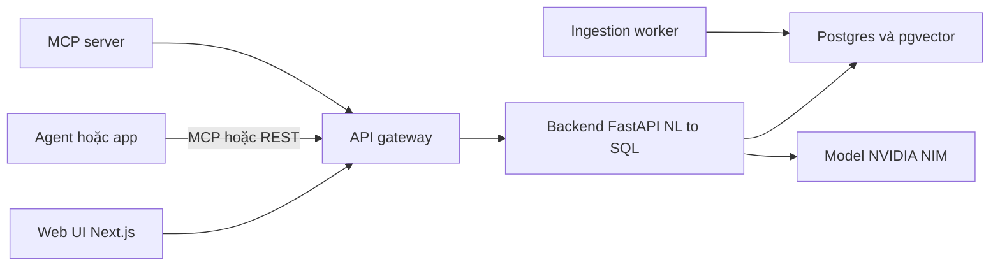
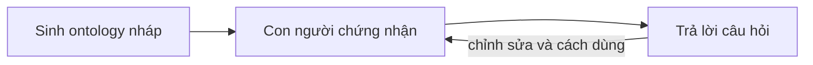
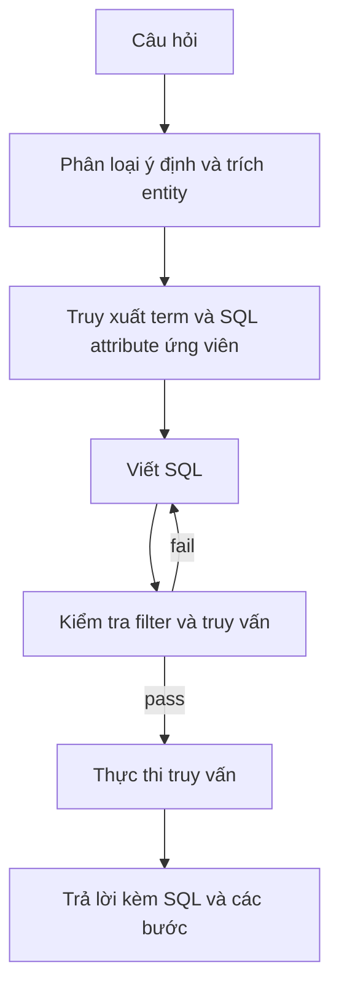

*Agent hiện đã biết truy xuất tài liệu và truy vấn cơ sở dữ liệu. Phần đó đã xong. Phần chưa xong là **niềm tin**: một con số doanh thu trả về nhanh hơn chẳng có giá trị gì nếu con số đó sai.*

Đó là tiền đề của [**NVIDIA Auto Ontology**](https://github.com/NVIDIA/auto-ontology) — một thư viện mở (Apache 2.0) xây lớp ngữ cảnh từ metadata doanh nghiệp và mở nó ra cho mọi agent harness qua **MCP, CLI và API**.

## Vấn đề nó nhắm tới

Để agentic analytics hữu ích, agent cần nhiều hơn một kết nối cơ sở dữ liệu. Nó cần biết:

- Dữ liệu **nằm ở đâu**
- Nó **có nghĩa gì**
- **Có nên** dùng nó không
- **Dùng thế nào**
- Nó **đến từ đâu**
- Cái gì **tương tự** với nó

Thiếu lớp đó, một agent text-to-SQL có thể tạo ra truy vấn nghe hợp lý nhưng trả lời một câu hỏi hơi khác — và không có gì trong pipeline bắt được điều đó. Auto Ontology đặt cược rằng nó xây đúng lớp này từ metadata bạn đã có, hoà giải các định nghĩa giữa các hệ thống, và phục vụ nó cho agent.

## Năm năng lực

Dự án tự mô tả bằng năm động từ:

- **Discover** — sinh ontology doanh nghiệp từ metadata; kết nối ontology và semantic model sẵn có; xây knowledge graph sẵn sàng cho AI.
- **Ground** — cấp cho agent ý nghĩa nghiệp vụ đáng tin cho metric, entity và quan hệ; hoà giải định nghĩa không nhất quán giữa các hệ thống.
- **Validate** — kiểm tra truy vấn được sinh ra dựa trên định nghĩa đã chứng nhận và lineage; trả về provenance kèm mọi câu trả lời.
- **Expose** — phục vụ ngữ cảnh cho mọi agent harness qua MCP, CLI và API.
- **Learn** — đưa các chỉnh sửa đã chứng nhận và cách dùng trở lại ontology, để ngữ cảnh chung tốt lên theo từng câu hỏi.

Nó được thiết kế rõ ràng để *bổ sung* cho các semantic model doanh nghiệp đã có, không phải thay thế.

## Kiến trúc

Đây là một full stack, không chỉ một thư viện:

| Thành phần | Công nghệ | Vai trò | Cổng |
|---|---|---|---|
| Frontend | Next.js 16, React 19, TypeScript, Tailwind 4, Better Auth, Prisma | Web UI, auth, API gateway | 3000 |
| Backend | FastAPI, Python 3.12+, LangChain | Chat / NL-to-SQL, catalog, API datasource | 3001 |
| Ingestion worker | FastAPI | Nạp dữ liệu bảng, ghi embedding | 3002 |
| MCP server | FastMCP | Tool chỉ-đọc cho agent qua public API | 3003 |
| Postgres + pgvector | PostgreSQL 17 | Catalog, ontology, dữ liệu app, vector store | 5432 |
| Vault | HashiCorp (tuỳ chọn) | Lưu credential kết nối | — |

Suy luận chạy qua **NVIDIA NIM** — API catalog hosted hoặc NIM tự host. Có bốn vai trò model: `REASONING`, `NON_REASONING`, `EMBED`, `RERANK`, mỗi vai trò cấu hình bằng bộ ba `ENDPOINT` / `API_KEY` / `MODEL`.

> Lưu ý bảo mật từ README: giữ cổng 3001 và 3002 trong mạng riêng. Backend tin header `x-auto-ontology-user-id` do frontend chuyển tiếp, và các endpoint của ingestion service không có auth riêng. Client nên đi qua web app ở cổng 3000.

## Cách hoạt động: generate → certify → answer

Auto Ontology chạy theo ba giai đoạn:

**1. Generate.** Ingestion service dựng bản nháp đầu tiên từ các nguồn: đọc schema và profile cột, trích term theo từng bảng rồi map vào cột, suy ra join và bridge table, gợi ý SQL attribute từ lịch sử truy vấn, rồi ghi ontology vào Postgres kèm embedding trong pgvector. Một lần compile cơ sở dữ liệu mẫu Wide World Importers của Microsoft tạo ra **31 term**.

**2. Certify.** Con người làm bản nháp trở nên đáng tin: thử bằng câu hỏi thật trong Chat hoặc qua MCP, tinh chỉnh term, description và SQL attribute, rồi chứng nhận khi đã đúng.

**3. Answer.** Với mỗi câu hỏi, agent phân loại ý định, trích entity, truy xuất term/cột/SQL attribute ứng viên bằng embedding search, viết SQL, kiểm tra filter và truy vấn với cơ sở dữ liệu, sửa khi kiểm tra fail, rồi chạy.

Bản thân ontology chứa ba loại định nghĩa:

- **Terms** — khái niệm nghiệp vụ (*Customer*, *Invoice Line*) với description và synonym, map vào cột.
- **SQL attributes** — biểu thức SQL đã review dưới một term, như margin hay rolling total, để mọi câu trả lời tính cùng một cách.
- **Relationships** — cách các bảng join, gồm cả bridge table, suy ra từ khoá và từ dữ liệu.

## Ví dụ bán được hàng

Trên Wide World Importers:

> *"Doanh thu của sản phẩm USB food flash drive - sushi roll ở Pennsylvania trong tháng 6/2015 là bao nhiêu?"*

Agent resolve *doanh thu*, *sản phẩm* và *bang* về các term trong ontology, đi theo quan hệ để tìm các join cần thiết, và trả về:

> **$588.80 từ 3 dòng invoice** — kèm SQL và các bước đã tạo ra kết quả.

Provenance chính là điểm mấu chốt. Bạn kiểm tra được con số với nguồn thay vì tin vào lời văn.

## Answerability là tính năng hạng nhất

Một ý tưởng sắc sảo hơn: agent nói được khi dữ liệu **không** trả lời được câu hỏi.

Hỏi về return on ad spend, `check_answerable` báo coverage 0.5 — không có term nào phủ "ad spend" — và agent hỏi lại: bạn muốn doanh thu tháng 6/2015 thay thế, hay ad spend nằm ở nguồn khác cần kết nối? Đó là kiểu thất bại tốt hơn nhiều so với một metric bịa ra đầy tự tin.

## Giao diện

Qua **MCP**, mọi client có bộ tool chỉ-đọc: `check_readiness`, `search_terms`, `get_term`, `get_term_columns`, `get_term_sql_attributes`, `get_sql_attribute`, `describe_table`, `check_answerable` và `ask_question`.

Ngoài ra có **REST API** (`POST /api/chat/completions`, stream SSE), CLI, và ba agent skill: setup, management, query.

## Triển khai và nguồn dữ liệu

Docker Compose cho stack local hoặc Helm chart cho Kubernetes. Nó kết nối **mười engine**: PostgreSQL, MySQL, Databricks, Snowflake, ClickHouse, Trino, Apache Kyuubi, HeavyDB, DuckDB và SQLite.

Với câu hỏi dự đoán, đặt `KUMO_RFM_API_KEY` để route sang KumoRFM — lưu ý dịch vụ này upload các bảng đã kết nối lên một dịch vụ hosted, nên là tuỳ chọn và nên qua bước review dữ liệu.

Nó cũng tương thích **Apache Ossie** — chuẩn mở để trao đổi semantic model — với import/export từ Settings hoặc API.

## Quan điểm của tôi

Ba điểm nổi bật:

1. **Ontology chính là lớp đảm bảo độ tin cậy.** Phần lớn tooling text-to-SQL tập trung vào model; cái này tập trung vào *ý nghĩa* của dữ liệu và ai đã chứng nhận nó. Đó là chỗ đúng để đặt ranh giới tin cậy.
2. **Answerability là tính năng, không phải lỗi.** Nói được "dữ liệu này không trả lời được câu đó" — kèm coverage score — là thứ ngăn agent tự tin bịa.
3. **MCP-first.** Biến lớp ngữ cảnh thành thứ mọi agent harness gọi được (thay vì chỉ UI của nó) là thứ biến nó thành hạ tầng.

Cần nói rõ các đánh đổi: đây là một stack thật để vận hành (Postgres, ba service, NIM endpoint), phụ thuộc NVIDIA NIM cho suy luận, công việc thật sự nằm ở bước con người chứng nhận, và dự án **không nhận đóng góp bên ngoài** — đây là thư viện mở do NVIDIA duy trì, integration request xử lý qua issue.

Nếu bạn đang xây agent trên dữ liệu doanh nghiệp và nỗi sợ lớn nhất là "tự tin nhưng sai", đáng để xem.

**Repo:** [github.com/NVIDIA/auto-ontology](https://github.com/NVIDIA/auto-ontology)
