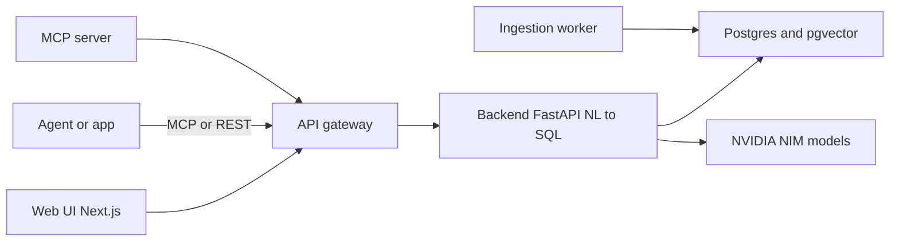
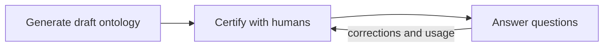
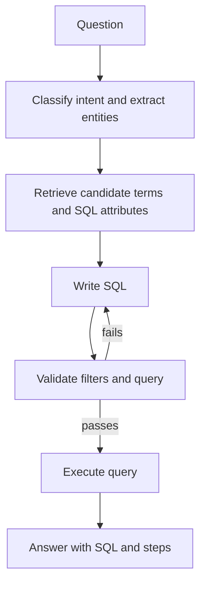

*Agents can already retrieve documents and query databases. That part is solved. The part that isn't solved is trust: a revenue number delivered faster is worth nothing if the number is wrong.*

That's the premise behind [**NVIDIA Auto Ontology**](https://github.com/NVIDIA/auto-ontology) — an open library (Apache 2.0) that builds a context layer from enterprise metadata and exposes it to any agent harness through **MCP, CLI, and API**.

## The problem it targets

For agentic analytics to be useful, an agent needs more than a database connection. It needs to know:

- **Where** the data lives
- **What** it means
- **Whether** it should be used
- **How** to use it
- **Where it came from**
- **What is similar** to it

Without that layer, a text-to-SQL agent can produce a plausible query that answers a slightly different question — and nothing in the pipeline catches it. Auto Ontology's pitch is that it builds exactly this layer from the metadata you already have, reconciles definitions across systems, and serves it to agents.

## Five capabilities

The project frames itself around five verbs:

- **Discover** — generate enterprise ontologies from metadata, connect existing ontologies and semantic models, build AI-ready knowledge graphs.
- **Ground** — give agents trusted business meaning for metrics, entities, and relationships; reconcile inconsistent definitions across systems.
- **Validate** — check generated queries against certified definitions and lineage; return provenance with every answer.
- **Expose** — serve context to any agent harness through MCP, CLI, and API.
- **Learn** — fold certified corrections and usage back into the ontology, so shared context improves with every question.

It's explicitly designed to *complement* semantic models customers already own, not replace them.

## Architecture

It's a full stack, not a single library:

| Component | Technology | Role | Port |
|---|---|---|---|
| Frontend | Next.js 16, React 19, TypeScript, Tailwind 4, Better Auth, Prisma | Web UI, auth, API gateway | 3000 |
| Backend | FastAPI, Python 3.12+, LangChain | Chat / NL-to-SQL, catalog, datasource APIs | 3001 |
| Ingestion worker | FastAPI | Ingests tabular data, writes embeddings | 3002 |
| MCP server | FastMCP | Read-only agent tools over the public API | 3003 |
| Postgres + pgvector | PostgreSQL 17 | Catalog, ontology, app data, vector store | 5432 |
| Vault | HashiCorp (optional) | Connection credential storage | — |

Inference runs through **NVIDIA NIM** — either the hosted API catalog or self-hosted NIMs. There are four model roles: `REASONING`, `NON_REASONING`, `EMBED`, and `RERANK`, each configured by an `ENDPOINT` / `API_KEY` / `MODEL` triplet.

> Security note from the README: keep ports 3001 and 3002 on a private network. The backend trusts a forwarded `x-auto-ontology-user-id` header, and the ingestion service endpoints have no auth of their own. Clients are meant to go through the web app on port 3000.

## How it works: generate → certify → answer

Auto Ontology runs in three stages:

**1. Generate.** The ingestion service builds a first draft from the source databases: read schemas and profile columns, extract terms table by table and map them to columns, infer joins and bridge tables, suggest SQL attributes from query history, then write the ontology to Postgres with embeddings in pgvector. One compilation of Microsoft's Wide World Importers sample database produced **31 terms**.

**2. Certify.** People make the draft trustworthy: test with real questions in Chat or over MCP, refine terms, descriptions and SQL attributes, then certify them once they're correct.

**3. Answer.** For each question the agent classifies intent, extracts entities, retrieves candidate terms/columns/SQL attributes by embedding search, writes SQL, validates filters and the query against the database, repairs when a check fails, then runs it.

The ontology itself holds three kinds of definition:

- **Terms** — business concepts (*Customer*, *Invoice Line*) with descriptions and synonyms, mapped to columns.
- **SQL attributes** — reviewed SQL expressions under a term, such as a margin or rolling total, so every answer computes a measure the same way.
- **Relationships** — how tables join, including bridge tables, inferred from keys and from the data.

## The demo that sells it

Against Wide World Importers:

> *"What was revenue for the USB food flash drive - sushi roll in Pennsylvania in June 2015?"*

The agent resolves *revenue*, *product*, and *state* to ontology terms, follows their relationships to the joins it needs, and returns:

> **$588.80 from 3 invoice lines** — with the SQL and the steps that produced it.

That provenance is the point. You can check the number against the source instead of trusting the prose.

## Answerability as a first-class feature

One of the sharper ideas: the agent can tell you when the data **can't** answer the question.

Ask about return on ad spend and `check_answerable` reports coverage 0.5 — no term covers "ad spend" — and the agent asks whether you want June 2015 revenue instead, or whether ad spend lives in another source. That's a much better failure mode than a confident hallucinated metric.

## Interfaces

Over **MCP**, any client gets read-only tools: `check_readiness`, `search_terms`, `get_term`, `get_term_columns`, `get_term_sql_attributes`, `get_sql_attribute`, `describe_table`, `check_answerable`, and `ask_question`.

There's also a **REST API** (`POST /api/chat/completions`, SSE stream), a CLI, and three agent skills: setup, management, and query.

## Deployment and sources

Docker Compose for a local stack or a Helm chart for Kubernetes. It connects to **ten engines**: PostgreSQL, MySQL, Databricks, Snowflake, ClickHouse, Trino, Apache Kyuubi, HeavyDB, DuckDB, and SQLite.

For predictive questions you can set a `KUMO_RFM_API_KEY` to route to KumoRFM — worth noting that this uploads your connected tables to a hosted service, so it's opt-in and should go through a data review.

It's also compatible with **Apache Ossie**, the open standard for exchanging semantic models, with import/export from Settings or the API.

## My take

Three things stand out:

1. **The ontology is the reliability layer.** Most text-to-SQL tooling focuses on the model; this focuses on the *meaning* of the data and who certified it. That's the right place to put the trust boundary.
2. **Answerability is a feature, not an error.** Being able to say "this data can't answer that" — with a coverage score — is what stops an agent from confidently making things up.
3. **MCP-first exposure.** Making the context layer callable from any agent harness (rather than only its own UI) is what turns it into infrastructure.

Worth being clear about the trade-offs: this is a real stack to operate (Postgres, three services, NIM endpoints), it depends on NVIDIA NIM for inference, human certification is the actual work, and the project is **not accepting external contributions** — it's an NVIDIA-maintained open library, with integration requests handled through issues.

If you're building agents over enterprise data and the failure mode you fear is "confidently wrong", it's worth a look.

**Repo:** [github.com/NVIDIA/auto-ontology](https://github.com/NVIDIA/auto-ontology)
